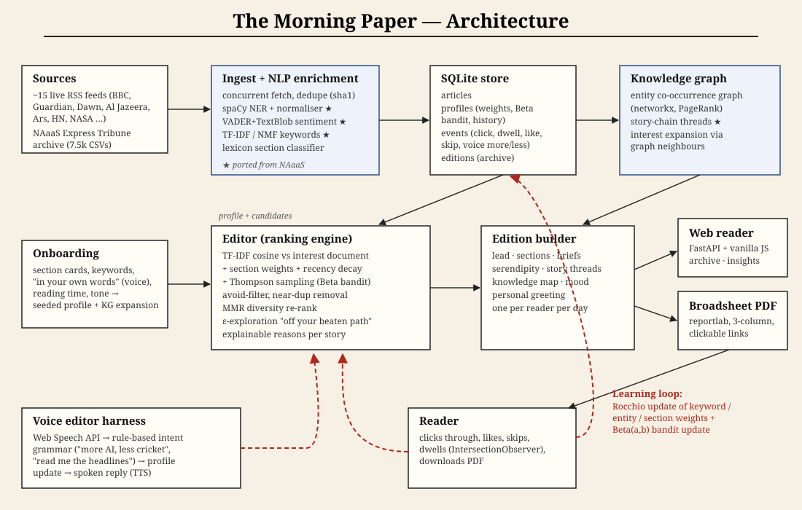
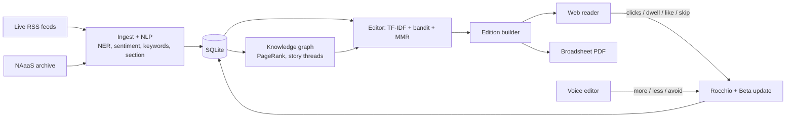

# The Morning Paper

One personal newspaper, every morning. It gathers articles from across the web, works out
what *you* care about, and sets them as a newspaper you can read on the web or download
as a broadsheet PDF. The more you read, skip, like, and talk to it, the better it gets.

The NLP and knowledge-graph layer is reused from our earlier **NAaaS (News Analytics as a
Service)** project: spaCy NER and entity normalisation, VADER+TextBlob sentiment,
TF-IDF/NMF topics, story-chain building, and the Express Tribune archive. The ranking and
learning use classical AI. None of it calls a paid LLM.



## What it does

| Requirement | How |
|---|---|
| **Onboarding** | 4 quick steps: name and city → tap section cards → "tell us in your own words" (typed or **spoken**) → reading time and tone. Free text is parsed by the intent grammar, then expanded through the knowledge graph (if you like *OpenAI*, you get a small prior on its graph neighbours). |
| **Daily PDF** | A fresh broadsheet every day (reportlab): masthead, lead story across the columns, 3-column sections, In Brief, *Off Your Beaten Path*, *Following the Story* timelines, mood bar, and your knowledge map. Links are clickable. |
| **Web page** | A full newspaper reading experience, with click-through to originals (tracked), *why this?* on every story, like / less-like-this / skip, PDF download, and an **archive** of past editions. |
| **Learning** | Every signal (click, dwell time, like, skip, voice "more/less") makes a **Rocchio-style update** to the keyword, entity, and section weights, and updates a per-section **Beta bandit** (Thompson sampling). The **Insights** page shows how your profile changed over time. |
| **Room to explore** | **Voice editor**: talk to your paper ("more about climate, less cricket", "read me the headlines", "surprise me"). A spoken reply comes back through TTS. Also: **knowledge map** of today's entities (PageRank), **story threads** across days, ε-greedy **serendipity** picks, and a mood meter. |

## Ranking (the "editor")
`score = α·cos(TF-IDF(article), interest-doc) + β·section_weight + γ·Thompson(Beta_section) + δ·recency + prior`
→ avoid-term filter → near-duplicate removal → **MMR** diversity re-rank → layout by reading-time budget.
Every card has human-readable reasons.

## Run
```bash
python3 -m venv .venv && .venv/bin/pip install -r requirements.txt
.venv/bin/python -m spacy download en_core_web_sm
.venv/bin/python -m backend.ingest          # pull today's news (falls back to the NAaaS archive offline)
.venv/bin/uvicorn backend.app:app --port 8900
# open http://localhost:8900
```

## Layout
```
backend/  db.py (SQLite) · ingest.py · nlp.py · kg.py · profile.py · ranker.py
          edition.py · voice.py · pdf.py · app.py (FastAPI)
frontend/ index.html · app.js · style.css   (vanilla JS, Web Speech API, SVG knowledge map)
docs/     CONTRACT.md (module interfaces) · architecture.svg
```


